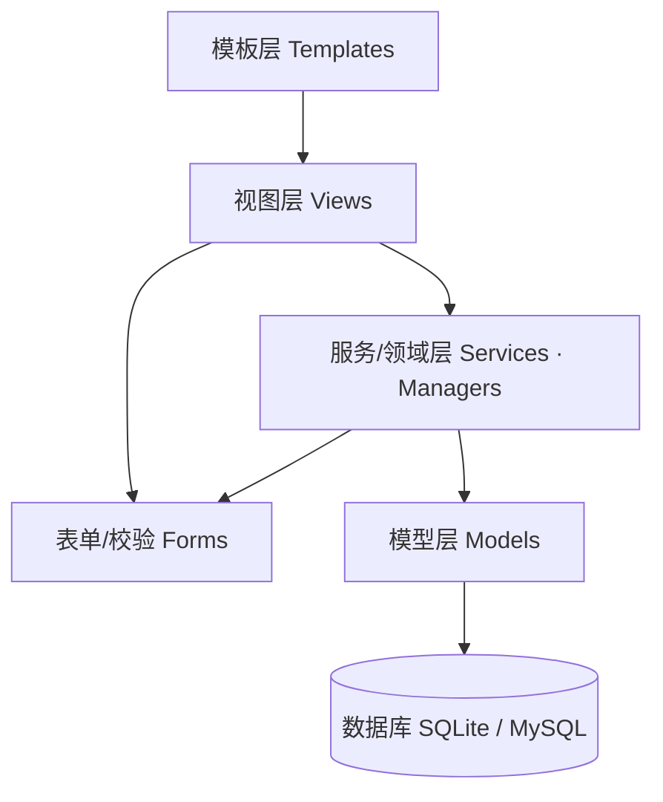
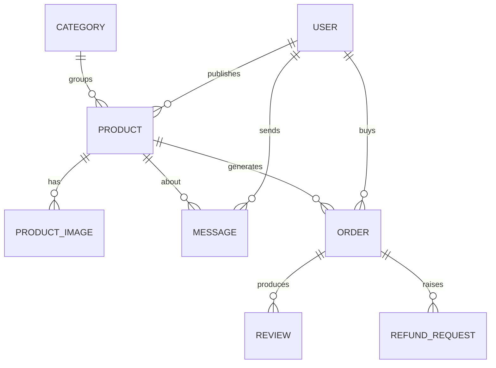
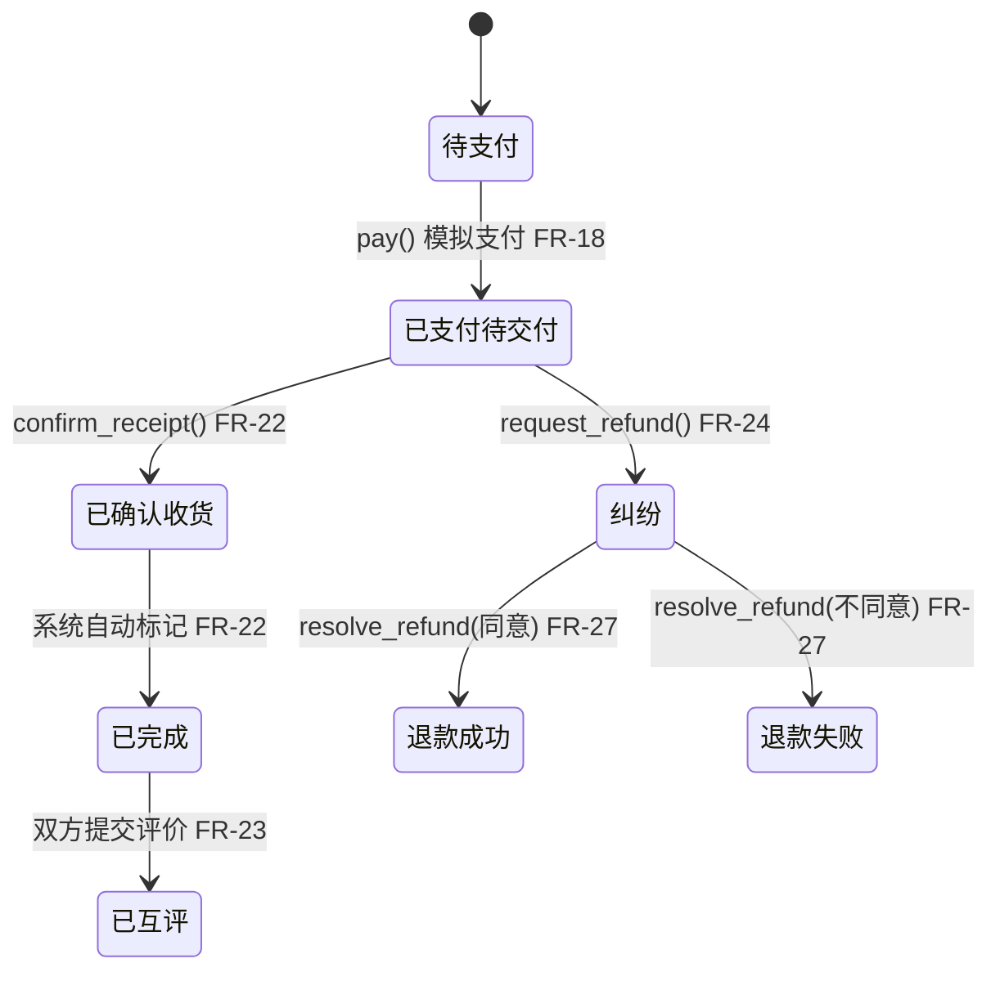
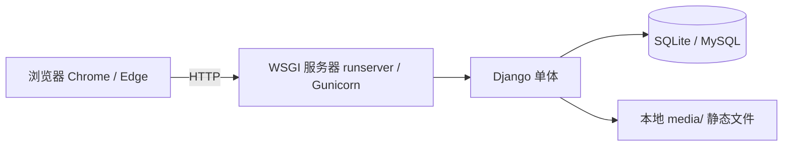

# 技术架构 — 校园二手书/闲置物品交易系统

本文件是系统的**架构骨架（architecture spine）**：只固定那些「独立开发的模块若不约定就会各写各的、且事后无法从代码反推」的不变量。技术栈与目录结构是**种子（seed）**——冷启动时成立，代码存在后归代码所有。决策的理由在 `.memlog.md` 与 `decision-log.md`，本文件只记录决策本身。

## 设计范式（Design Paradigm）

**分层单体（Layered Monolith），落地为 Django 的 MTV（Model-Template-View）模式。** 一个可部署单元，按业务域垂直切分为若干 Django app，层间单向依赖。



- 依赖方向自上而下、**单向**：模板 → 视图 → 服务/模型 → 数据库；下层禁止反向 import 上层。
- 业务规则（订单状态机、权限、审核门控）一律下沉到 **Models/Services 层**，视图只做请求编排，模板只做渲染。
- 命名空间按 app 映射（见「结构种子」），每个 app 拥有自己的 `models.py / views.py / forms.py / urls.py` 与 `templates/<app>/`。
- **app 是同一 Django 项目内的组织切片**，共享同一数据库与 ORM；同层跨 app import 允许（如 `dashboard.views` → `listings.models` / `orders.models`）。但**实体及其生命周期方法归其所属 app 唯一定义，其他 app 只调用、不复刻**：订单状态机归 `orders`、商品可见性归 `listings`、学号认证位归 `accounts`，管理员后台（`dashboard`）复用这些方法而非另写一套。

范式依据：单团队、纯网页端、无实时推送（PRD §6、§7.1）、演示驱动（NFR-6、SM-1），单体分层是复杂度下限，是「不过度复杂、也不过于简陋」的正确落点（见 AD-1）。

## 不变量与规则（Invariants & Rules）

以下每条 AD 都给出：**约束对象（Binds）**、**防止的分歧（Prevents）**、**可执行的规则（Rule）**、**否决的备选方案**，以及**理由回指的 PRD 条目**。

### AD-1 — 整体形态：分层单体（拒绝 SPA 前后端分离 / 微服务）

- **Binds:** 全部 app、模块、部署形态
- **Prevents:** 前后端分离（SPA）引入的双应用、独立前端构建链、CORS 与鉴权同步复杂度；微服务引入的服务发现、RPC、多库一致性与运维负担
- **Rule:** 系统为**单一可部署的 Django 单体**，按 `accounts / listings / chat / orders / dashboard` 五个 app 垂直切分；禁止引入独立前端构建产物（React/Vue bundle）与服务间 RPC；前端为 Django 模板 + Bootstrap 的服务端渲染页面。
- **否决的备选:** ① React/Vue 单页应用 + REST API 前后端分离；② 微服务拆分
- **回指 PRD:** §6「不做移动端 App」、§7.1 单团队 MVP、NFR-5/6（演示可用）、D-008（不要过度复杂）

### AD-2 — 数据存储：关系型数据库（拒绝 NoSQL）

- **Binds:** 全部数据模型、订单状态、统计看板
- **Prevents:** 文档型 NoSQL 下，订单状态机、用户-商品-订单-评价的多表关联、以及看板聚合（用户数/发布数/成交数/纠纷数）难以用 JOIN/事务保证一致
- **Rule:** 采用**关系型数据库**，全程走 Django ORM，schema 变更用 migrations 管理；开发/演示用 **SQLite**（零配置），生产可选 **MySQL 8.4 LTS**。
- **否决的备选:** MongoDB 等文档型 NoSQL
- **回指 PRD:** FR-20（订单状态机）、FR-29（数据看板聚合统计）、NFR-3（数据一致性）

### AD-3 — 认证与会话：服务端 Session（拒绝 JWT）

- **Binds:** 注册/登录/登出、学号认证、鉴权
- **Prevents:** 无状态 JWT 在服务端渲染单体里的令牌刷新/吊销复杂度、以及令牌泄露后的失控窗口；「学号认证」需管理员核实后置位，天然需要服务端可撤销状态
- **Rule:** 使用 **Django 内置认证 + 服务端 Session**（`HttpOnly` Cookie）；学号认证实现为 `User` 上的 `is_verified` 布尔位，用户提交「学号 + 姓名」后**由管理员人工审核**，通过即置真；审核标准为「学号、姓名符合格式规则即可」（学号格式、姓名非空），**不做真实名单对照**（第三方无法取得学生名单）；密码哈希 + 加盐存储（Django 默认 PBKDF2）。
- **否决的备选:** JWT 无状态令牌
- **回指 PRD:** FR-1/FR-2/FR-3/FR-28、NFR-2（密码不存明文、鉴权）、NFR-4（学号不公开）

### AD-4 — 授权模型：服务端强制 RBAC（拒绝前端隐藏式控制）

- **Binds:** 全部视图、管理员后台
- **Prevents:** 仅靠前端隐藏按钮/菜单实现的「伪权限」，越权访问可绕过；学生访问他人订单/消息/评价
- **Rule:** 权限在**服务端**（视图装饰器 / 模型查询过滤）强制校验；角色分 `student` / `admin` 两类；学生只能读写本人数据，管理员功能（审核/下架/纠纷裁决/用户管理/看板）仅 `admin` 可入。
- **否决的备选:** 仅前端隐藏入口、服务端不做授权校验
- **回指 PRD:** FR-25~FR-29（管理员后台）、NFR-2（越权访问被拒绝）、FR-3/FR-28

### AD-5 — 订单状态机：服务端单一状态机（拒绝开放状态字段）

- **Binds:** 订单、退款、评价模块
- **Prevents:** 任意代码或前端自由改 `status` 字段导致的非法跳转（如跳过支付直接确认收货、确认收货后再退款）
- **Rule:** 订单状态**仅**沿 FR-20 定义的状态机流转；每个合法转移封装为 Model 方法（`pay()` / `confirm_receipt()` / `request_refund()` / `resolve_refund()`），非法转移抛错拒绝；状态枚举与合法转移表在 **models 层唯一定义**，视图不得直接改状态字段。
- **否决的备选:** 状态字段开放 update、由前端控制流转顺序
- **回指 PRD:** FR-20（状态机 + 非法跳转拒绝）、FR-22/FR-24（确认收货后不可退款）、NFR-3（一致性）

### AD-6 — 模拟支付：服务端占位动作（拒绝真实第三方支付）

- **Binds:** 订单支付环节
- **Prevents:** 接入微信/支付宝真实支付或沙箱带来的商户资质、密钥、回调签名、对账与合规成本，超出课堂作业尺度
- **Rule:** 支付为一个服务端**原子操作**（订单 `待支付 → 已支付/待交付`），在**单个数据库事务**内完成，**不调用任何外部支付网关**。
- **否决的备选:** 微信/支付宝真实支付，或其沙箱环境
- **回指 PRD:** FR-18（仅做状态流转）、§6「不做真实第三方支付」、D-004

### AD-7 — 站内聊天：纯文字 + HTTP 轮询（拒绝 WebSocket 实时推送）

- **Binds:** 聊天模块（FR-13~FR-16）
- **Prevents:** WebSocket / 长轮询的实时推送引入的连接管理、通道层（ASGI/channel）复杂度与演示稳定性风险
- **Rule:** 消息**仅纯文本**（拒绝图片/富文本）；读取采用页面刷新或**定时 HTTP 轮询**（约 5 秒一次）；**不引入 WebSocket / ASGI channel 层**；未读数在服务端按会话维护。
- **否决的备选:** WebSocket / 长轮询实时推送；图片或富文本聊天
- **回指 PRD:** FR-15（纯文字 + 轮询刷新）、§6「不做完整即时通讯」、D-014

### AD-8 — 图片存储：本地文件系统（拒绝云对象存储）

- **Binds:** 商品图片上传与展示
- **Prevents:** 云对象存储（OSS/COS）引入的账号、计费、SDK 与网络依赖，超出课堂作业尺度
- **Rule:** 图片经 **Pillow** 校验（格式限 JPEG/PNG）并缩略后存至本地 `media/`，由 Django 静态媒体服务返回；限制单图尺寸（如 ≤ 5MB）与每商品图片张数。
- **否决的备选:** 阿里云 OSS / 腾讯 COS 等对象存储
- **回指 PRD:** FR-5（图片上传 ≥1 张）、NFR-1（性能）、§7.1 MVP

### AD-9 — 先审后上架：可见性由状态字段驱动（拒绝「发布即上架」）

- **Binds:** 商品发布/列表/搜索/详情
- **Prevents:** 「发布即上架」让违规商品直接对外可见，架空「同校可信」与管理员审核
- **Rule:** 商品可见性由 `status` 字段驱动（`pending` 待审核不可见、`approved` 上架可见、`rejected`/`offline` 不可见）；**列表与搜索查询在服务端强制过滤 `status=approved`**，待审核/驳回商品对普通用户不可见。
- **否决的备选:** 发布即上架（免审核）
- **回指 PRD:** FR-6（先审后上架）、FR-9（列表只含上架）、NFR-3（待审核不可被搜索）、D-011

### AD-10 — 部署与运行环境：单机本地演示（拒绝容器化/云部署）

- **Binds:** 部署、运行环境
- **Prevents:** Docker/K8s 容器编排或云平台部署的复杂度与成本，超出课堂演示尺度
- **Rule:** **本地单机运行**（开发用 `runserver`，演示可用 Gunicorn）；演示数据库为 **SQLite**；目标浏览器为最新版 Chrome / Edge。
- **否决的备选:** Docker/K8s 容器化、云平台部署
- **回指 PRD:** NFR-5（Chrome/Edge 兼容）、NFR-6（演示无阻断）、SM-1（演示流畅）、§7.1

## 一致性约定（Consistency Conventions）

| 关注点 | 约定 |
| --- | --- |
| 命名（实体/文件/接口/事件） | 遵循 Django 约定：app 复数小写（`accounts`/`listings`/`chat`/`orders`/`dashboard`）；Model 单数 CamelCase；字段 snake_case；URL 用语义命名（如 `/listings/<id>/`） |
| 数据与格式（ID/日期/枚举/错误） | 主键自增 int；价格 `DecimalField(10,2)`；**成色 `choices` = 全新 / 良好 / 中等**；分类 `choices` = 教材 / 日用品 / 电子数码 / 其他（FR-5）；订单状态用 `choices` 枚举；时间统一 UTC（`USE_TZ=True`）；错误统一为表单错误或 JSON（API 处） |
| 状态与横切（变更/错误/日志/配置/鉴权） | 状态机在 **models 层**；鉴权用 `login_required` / 权限装饰器；图片存 `media/`；日志用 Django logging；敏感配置（SECRET_KEY、DB 口令）走环境变量，不入库 |

## Stack（技术栈）

| Name | Version |
| --- | --- |
| Python | 3.14（当前稳定 3.14.10） |
| Django | 5.2 LTS（支持至 2028-04） |
| SQLite | 3.x（Python 内置，开发/演示） |
| MySQL | 8.4 LTS（可选，生产） |
| Pillow | 13.0 |
| Bootstrap | 5.3 |

版本为撰写日（2026-11-05）经联网核实的当前稳定版；代码一旦建立，以 `requirements.txt` 锁定为准。

## 结构种子（Structural Seed）

### 源码目录（Django 单体）

```text
my_project/
  config/            # Django 项目配置（settings.py / urls.py / wsgi.py）
  accounts/          # 用户、学号认证、个人中心（FR-1~FR-4）
  listings/          # 商品发布 / 审核 / 上架 / 浏览 / 搜索（FR-5~FR-12）
  chat/              # 站内聊天（FR-13~FR-16）
  orders/            # 订单 / 模拟支付 / 状态机 / 评价 / 退款（FR-17~FR-24）
  dashboard/         # 管理员后台：审核 / 纠纷裁决 / 用户管理 / 看板（FR-25~FR-29）
  media/             # 上传图片（运行时，AD-8）
  static/            # 静态资源（Bootstrap / CSS / JS）
  templates/         # 服务端模板（按 app 分目录）
  manage.py
  requirements.txt
```

### 核心实体关系（ERD）



实体属性在代码中定义（属性若本身是不变量则已上升为 AD，如订单状态、商品状态、学号认证位）。`USER` 为 Django 内置 `User` 扩展（`student_id`、`is_verified`、`role`）。

### 订单状态机（AD-5 的唯一合法转移）



### 部署与环境（运行包络）



## 能力 → 架构映射（Capability → Architecture Map）

| 能力 / 区域 | 落在何处 | 受何约束 |
| --- | --- | --- |
| FR-1~FR-4 账号与学号认证 | `accounts` app | AD-3、AD-4 |
| FR-5~FR-8 发布与审核 | `listings` app | AD-8、AD-9 |
| FR-9~FR-12 浏览 / 搜索 / 详情 | `listings` app | AD-2、AD-9 |
| FR-13~FR-16 站内聊天 | `chat` app | AD-7 |
| FR-17~FR-24 订单 / 支付 / 评价 / 退款 | `orders` app | AD-2、AD-5、AD-6 |
| FR-25~FR-29 管理员后台 | `dashboard` app（+ Django Admin 作为基座） | AD-4、AD-2 |
| NFR-1~NFR-6 非功能（横切） | 全系统 | AD-1~AD-10 |

## Deferred（推迟的决策）

- **生产部署细节**（Gunicorn 调优、静态文件 CDN、备份策略）：超出课堂作业尺度，待真实上线再定（AD-10 只到单机演示）。
